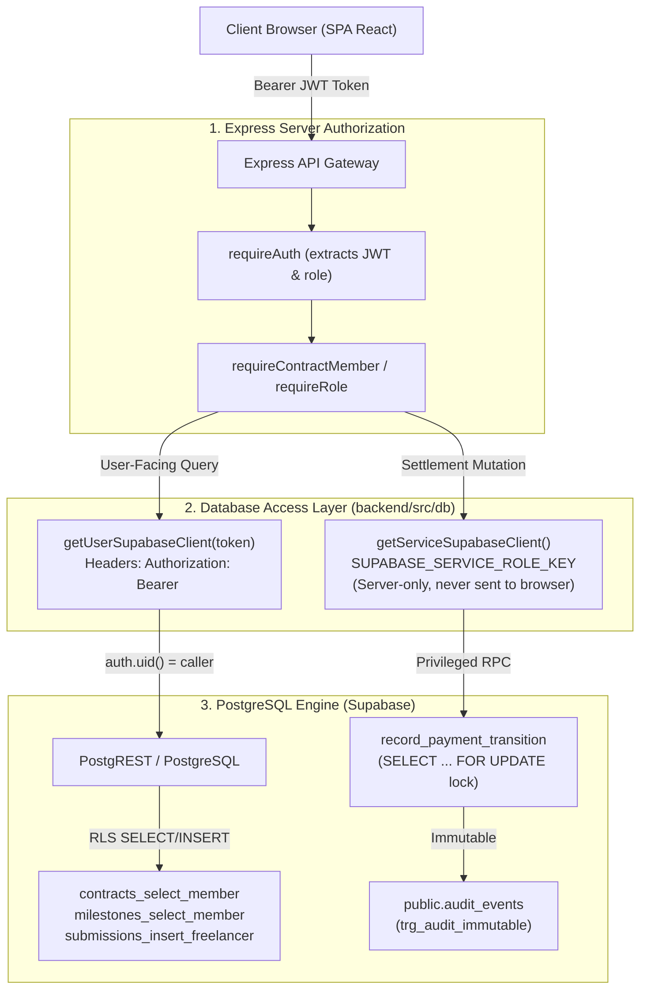

# MilestoneShield AI — Supabase Runtime Integration & Database Isolation Architecture

## 1. Executive Architecture Overview

MilestoneShield AI bridges Express API routes with PostgreSQL via Supabase, enforcing dual-layer security:
1. **Application Layer**: Express middleware verifies JWT signatures, ensures email verification, enforces role bounds (`client` vs `freelancer`), and validates input schemas.
2. **Database Layer (PostgreSQL RLS)**: Row-Level Security policies evaluate the caller's identity (`auth.uid()`) and contract memberships directly inside the PostgreSQL query engine.



---

## 2. User-Scoped Client vs. Service-Role Client Separation

### A. User-Scoped Supabase Client (`getUserSupabaseClient(token)`)
* **Usage**: All user-facing read and write queries (Contracts, Milestones, Submissions).
* **Mechanism**: Instantiated with `SUPABASE_ANON_KEY` and passes the caller's raw Bearer token via `global.headers.Authorization = 'Bearer ' + token`.
* **Security Enforcement**: PostgREST decodes the token and sets `request.jwt.claim.sub` in PostgreSQL session configuration. Every query evaluates against `auth.uid()`. Cross-tenant reads return 0 rows at the database engine level.

### B. Service-Role Supabase Client (`getServiceSupabaseClient()`)
* **Usage**: Financial ledger records and tamper-evident audit logging.
* **Security Boundary**: The service role bypasses PostgreSQL RLS. Therefore:
  * It is strictly confined to server-side code; it is **NEVER** imported or exposed to the frontend browser bundle.
  * It is executed **only after** Express server-side guards ([`requireContractMember`](file:///C:/milestone-shield-ai/milestone-shield-ai/backend/src/middleware/contractGuard.ts#L43-L80) and [`requireRole(['client', 'admin'])`](file:///C:/milestone-shield-ai/milestone-shield-ai/backend/src/middleware/contractGuard.ts#L18-L37)) have authorized the action.
  * Direct client INSERT, UPDATE, and DELETE operations on `public.payments` and `public.audit_events` are revoked via SQL grants and RLS policies (`WITH CHECK (false)`).

---

## 3. Database Schema & Migration Inventory (001–008)

| Migration | File | Tables / Objects Created | Security Controls & Grants |
| :--- | :--- | :--- | :--- |
| **001** | `001_create_profiles.sql` | `public.profiles`, `handle_new_user()` trigger | `SET search_path = public, pg_temp;` Prevents admin escalation in metadata. |
| **002** | `002_create_contracts_and_memberships.sql` | `public.contracts`, `public.contract_memberships` | Multi-tenant contract-to-user membership mapping with unique constraints. |
| **003** | `003_create_milestones_and_submissions.sql` | `public.milestones`, `public.submissions` | Parent-contract foreign keys (`ON DELETE CASCADE`), milestone order indices. |
| **004** | `004_create_payments_and_audit.sql` | `public.payments`, `public.audit_events` | `ON DELETE RESTRICT` on payments; `prevent_audit_tampering()` trigger blocks updates/deletes. |
| **005** | `005_rls_policies.sql` | RLS enabled on all 7 tables | `contracts_select_member`, `milestones_select_member`, `submissions_insert_freelancer`. |
| **006** | `006_storage_policies.sql` | Storage bucket `deliverables` | Private bucket, 25MB limit, MIME whitelist, RLS restricted to contract members. |
| **007** | `007_hardening_grants_and_triggers.sql` | Auto-membership trigger, column grants | `REVOKE ALL FROM anon;` Column-level `GRANT UPDATE (full_name, avatar_url) ON profiles`. |
| **008** | `008_runtime_enhancements.sql` | `acceptance_criteria`, `approve_url`, transition RPC | `record_payment_transition` RPC with `SELECT ... FOR UPDATE` lock and auto-status trigger. |

---

## 4. Transaction Boundaries & Concurrency Control

Financial state transitions (such as authorizing, capturing, or voiding milestone funds) require strict concurrency guarantees to prevent double-capture or replay attacks:

1. **Row-Level Locking**: In migration 008, [`record_payment_transition`](file:///C:/milestone-shield-ai/milestone-shield-ai/backend/migrations/008_runtime_enhancements.sql#L56-L120) issues:
   ```sql
   SELECT contract_id, status FROM public.payments WHERE id = p_payment_id FOR UPDATE;
   ```
   This acquires an exclusive row lock in PostgreSQL. Concurrent requests targeting the same payment block until the initial transaction commits.
2. **State Transition Validation**: If `v_curr_status = 'captured'` and an operator attempts a second capture, the procedure throws an exception (`Duplicate capture rejected`), preventing duplicate release of funds.
3. **Audit Immutability**: Every status update appends an immutable audit event to `public.audit_events` within the same transaction.

---

## 5. Persistence Status: PostgreSQL vs. In-Memory Compatibility Layer

To support both live PostgreSQL deployments and offline testing/development environments, MilestoneShield AI implements a maintainable dual-mode compatibility layer:

| Domain | When Supabase Configured (`isSupabaseConfigured() = true`) | Offline / Test Mode Fallback (`isSupabaseConfigured() = false`) |
| :--- | :--- | :--- |
| **User Profiles** | PostgreSQL `public.profiles` via Supabase Auth sync | In-memory `profilesStore` in [`users.ts`](file:///C:/milestone-shield-ai/milestone-shield-ai/backend/src/routes/users.ts#L40) |
| **Contracts & Memberships** | PostgreSQL `public.contracts` & `contract_memberships` | In-memory `contractsStore` in [`contracts.ts`](file:///C:/milestone-shield-ai/milestone-shield-ai/backend/src/models/contracts.ts#L31) |
| **Milestones** | PostgreSQL `public.milestones` with acceptance criteria | In-memory `milestonesStore` in [`milestones.ts`](file:///C:/milestone-shield-ai/milestone-shield-ai/backend/src/models/milestones.ts#L36) |
| **Deliverable Submissions** | PostgreSQL `public.submissions` via freelancer RLS | In-memory `submissionsStore` in [`submissions.ts`](file:///C:/milestone-shield-ai/milestone-shield-ai/backend/src/models/submissions.ts#L26) |
| **PayPal Payment Ledger** | PostgreSQL `public.payments` via service-role RPC | In-memory `payments` map in [`paymentStore.ts`](file:///C:/milestone-shield-ai/milestone-shield-ai/backend/src/services/paymentStore.ts#L75) |
| **Audit Events** | PostgreSQL `public.audit_events` (immutable trigger) | In-memory `auditTrail` and `userAuditLog` arrays |

---

## 6. Real-Database Verification Runbook

### Step 1: Link Disposable Test Project
```bash
npm install -g supabase
supabase login
supabase link --project-ref <your-test-project-ref>
```

### Step 2: Push All Migrations
```bash
supabase db push
```

### Step 3: Run Database Isolation & Concurrency Suites
Execute the test scripts using `psql` against your test database connection string. Both suites execute inside transaction blocks ending in `ROLLBACK`, guaranteeing zero test pollution:
```bash
# 1. Multi-Tenant Isolation & RLS Test
psql "<TEST_DATABASE_URL>" -f backend/migrations/tests/001_test_rls_isolation.sql

# 2. Payment Immutability & Concurrency RPC Test
psql "<TEST_DATABASE_URL>" -f backend/migrations/tests/002_test_payments_and_concurrency.sql
```
